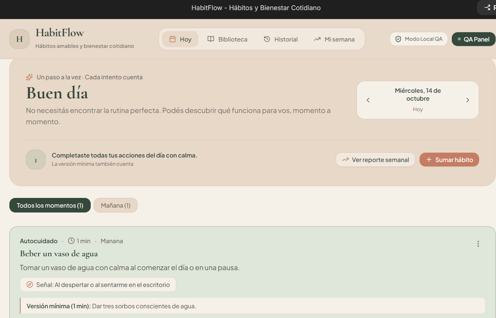
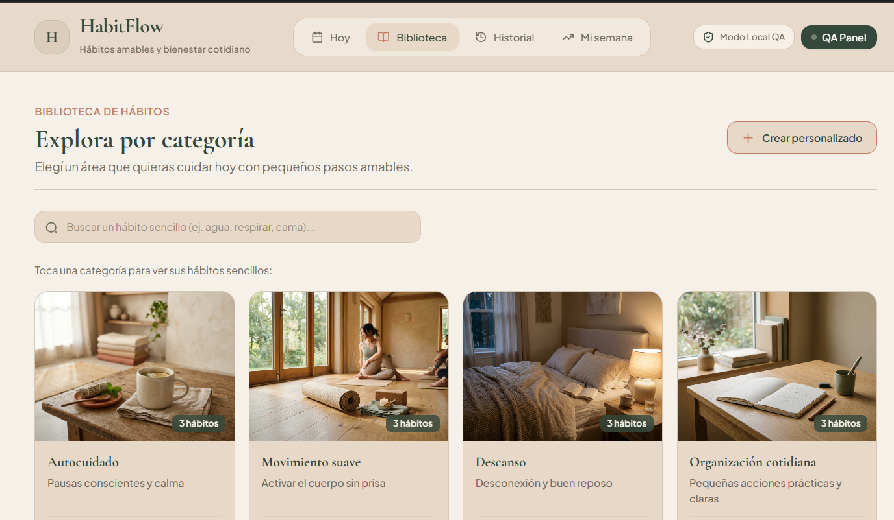

# QA Portfolio — Victoria Paula Del Giovine

QA Tester en formación, basada en Madrid, España.

Vengo del área de atención al cliente, donde desarrollé habilidades de comunicación, análisis de incidencias y orientación al usuario que hoy aplico al testing de software.

Mi formación en QA incluye práctica en testing manual, diseño y documentación de casos de prueba, reporte de bugs, API testing y automatización en desarrollo. Actualmente continúo ampliando mis conocimientos en automatización y herramientas de testing.

## Stack técnico

- **Testing manual:** diseño y ejecución de casos de prueba, checklists, planes de prueba y reportes de bugs.
- **Gestión y documentación:** Jira, Confluence, Zephyr y GitHub Projects.
- **API testing:** Postman.
- **Automatización:** Playwright + TypeScript, en formación y práctica.
- **Otras herramientas en aprendizaje:** Cypress.
- **Bases de datos:** SQL básico, en formación.
- **Metodologías:** Scrum / Agile.
- **Control de versiones:** Git y GitHub.

## Proyectos del portfolio

### 1. HabitFlow — Aplicación de hábitos y bienestar cotidiano

**Estado:** proyecto personal en desarrollo.

HabitFlow es una aplicación que estoy construyendo para practicar el ciclo de desarrollo y QA de un producto digital desde sus primeras etapas. Su objetivo es facilitar la organización de hábitos mediante pequeñas acciones cotidianas, con una experiencia visual cálida y un enfoque flexible, sin presión por mantener rachas perfectas.

La aplicación cuenta con una biblioteca de hábitos organizada por categorías, gestión de hábitos y vistas para consultar el seguimiento y el historial.

**Enfoque de QA**

Estoy incorporando el enfoque de calidad desde el inicio del proyecto, trabajando progresivamente en:

- Organización y documentación de los requisitos y funcionalidades.
- Identificación de escenarios de prueba y posibles casos límite.
- Diseño y ejecución de pruebas manuales.
- Registro y seguimiento de incidencias y resultados.
- Práctica progresiva de automatización con las herramientas que estoy aprendiendo.
- Organización del trabajo y control de versiones mediante Git y GitHub.

Utilizo Google AI Studio como herramienta de apoyo durante la construcción de la aplicación. El objetivo del proyecto es documentar el proceso, comprender las decisiones tomadas y desarrollar habilidades prácticas de testing.

**Capturas de la aplicación**

**Estado y alcance**

HabitFlow es un proyecto educativo y de portfolio. Actualmente se encuentra en desarrollo, no se presenta como un producto terminado y su código fuente se mantiene en un repositorio privado mientras continúo trabajando en él.

El nombre HabitFlow es provisional y se utiliza como referencia de trabajo en este portfolio.

---

### 2. Contact List App

Aplicación web de práctica utilizada para trabajar el proceso de testing y documentar distintos tipos de pruebas.

**Documentación**

- [Plan de pruebas](./01-contact-list-app/plan-de-pruebas.md)
- [Suite de casos de prueba](./01-contact-list-app/suite-casos-gestion-contactos.md)
- [API Testing](./01-contact-list-app/testing-api.md)
- [Reporte de bugs](./01-contact-list-app/reporte-de-bugs.md)
- [README del proyecto](./01-contact-list-app/contact-list-app-readme.md)

---

### 3. App BiT — No Country | Proyecto en equipo

Aplicación web B2G (Business to Government) que consolida datos públicos de movilidad, empleo y salud mental por región, e incorpora un agente de IA para consultas en lenguaje natural.

Proyecto colaborativo desarrollado por un equipo de 11 personas durante una simulación laboral ágil de cinco semanas.

**Mi participación en QA**

- Diseño y ejecución de la mayor parte de la suite de casos de prueba funcionales, incluyendo interfaz, mapa, chat, agente de IA y manejo de errores.
- Definición de criterios de aceptación de rendimiento ante la ausencia de lineamientos formales del negocio.
- Pruebas de estabilidad del endpoint de IA y documentación de latencia fuera del umbral establecido.
- Diseño de cuatro plantillas de GitHub Issues: caso de prueba, prueba de rendimiento, reporte de bug y épica/historia de usuario. Las plantillas fueron adoptadas por el equipo.
- Presentación del trabajo de QA durante la demo final del proyecto.

**Enlaces**

- [Ver carpeta del proyecto](https://github.com/victoriadelgiovine/qa-portfolio/tree/main/02-no-country-app-bit)
- [Ver demo del proyecto](https://www.youtube.com/watch?v=6J1Fv5hbul0)

## Formación continua

- **QA Testing:** formación en Talento Lab, Argentina.
- **Automatización de pruebas:** formación y práctica progresiva con Playwright + TypeScript.
- **QA Automation:** formación en curso, incluyendo herramientas como Cypress y Postman.
- **Desarrollo de aplicaciones no-code:** formación en Google AI Studio y aplicación práctica de los conocimientos en HabitFlow.

## Contacto

- **Email:** [victoriadelgiovine@gmail.com](mailto:victoriadelgiovine@gmail.com)
- **GitHub:** [victoriadelgiovine](https://github.com/victoriadelgiovine)
- **Portfolio QA:** [qa-portfolio](https://github.com/victoriadelgiovine/qa-portfolio)
